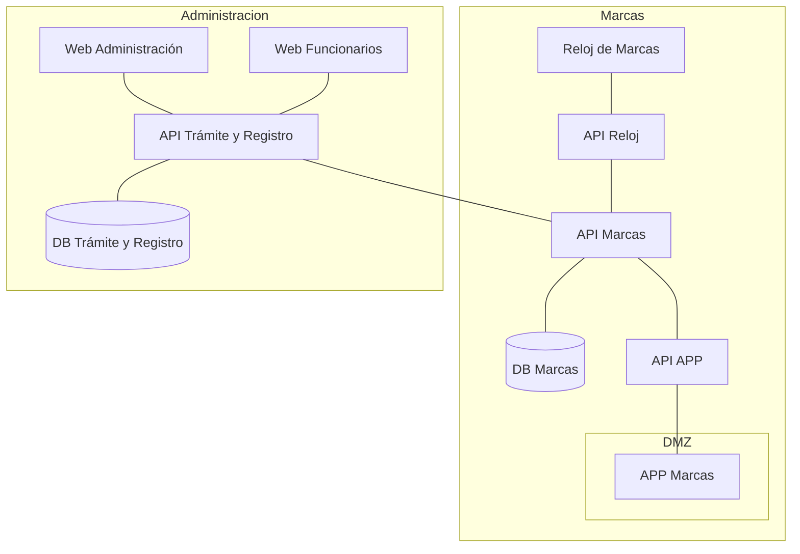

## Arquitectura General

### Reloj de Marcas

Las dos formas de integrarse

|              | Pull (SDK zkemkeeper)                    | Push (ADMS / iClock)                                      |
| ------------ | ---------------------------------------- | --------------------------------------------------------- |
| Quién inicia | Su servidor se conecta al reloj          | El reloj llama a su servidor                              |
| Dónde corre  | Solo Windows (COM)                       | Cualquier servidor HTTP (ASP.NET Core)                    |
| Red          | El reloj debe ser alcanzable (LAN o VPN) | El reloj solo necesita salir hacia su servidor            |
| Tiempo real  | No, por sondeo periódico                 | Casi inmediato                                            |
| Modelo       | MB360                                    | Solo aplicable para modelos KF160, 460 - MB160, 360, 460) |

| Marcas                               | Modelos                         |
| ------------------------------------ | ------------------------------- |
| [ZKteco](https://www.zkteco.com/en/) | [Reloj de Marcas](https://es.scribd.com/document/476568909/BIOMETRICO-MB360-pdf) |

### API Reloj

| Protocolo | Documentacion                                                                                                                                |
| --------- | -------------------------------------------------------------------------------------------------------------------------------------------- |
| Push      | [PUSH Communication Protocol Manual](https://studylib.net/doc/27718586/ilide.info-attendance-push-communication-protocol-2020032...?p=5) |
| Pull      | [API Reloj - ZKBioModule SDK.pdf](https://es.scribd.com/document/651682355/ZKBioModule-SDK-for-Windows)|
